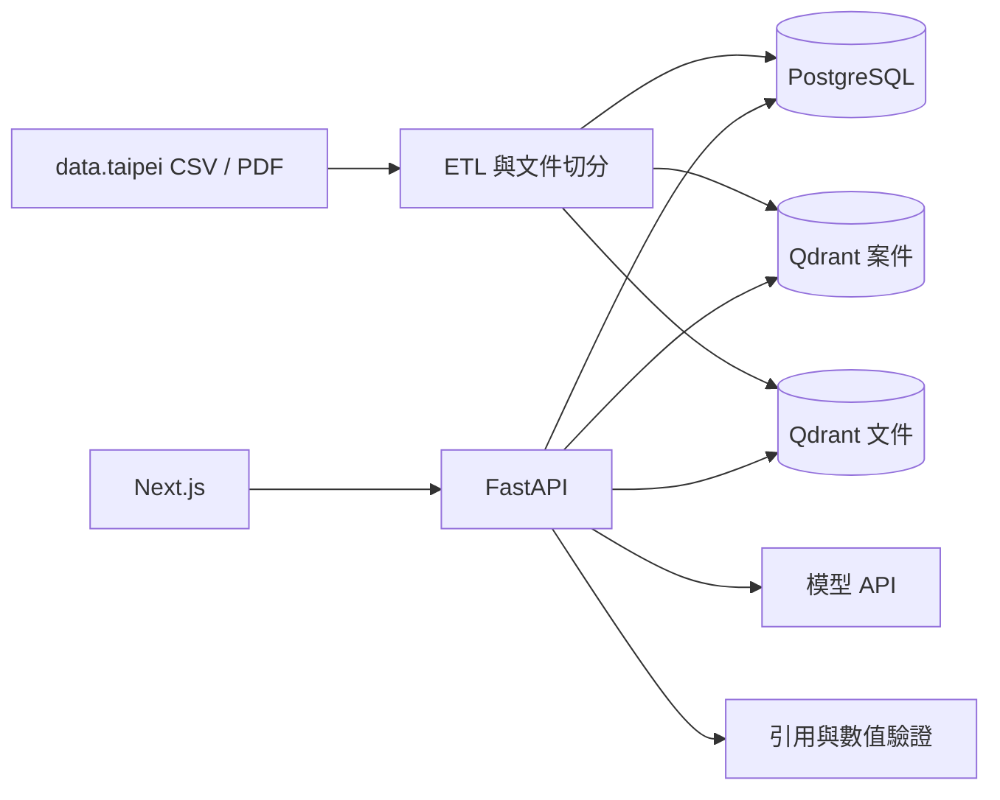

# 採購與報價知識助理

以臺北市資料大平臺公開採購資料建立的作品集 RAG 專案。系統將可驗證的 SQL 條件查詢、Qdrant 語意搜尋、採購文件問答與歷史決標金額統計放在同一個介面，回答中的案件、金額與文件頁碼都必須能追溯來源。

目前已完成模組與查詢流程接線；本地整合測試使用固定資料與模擬模型，不代表已通過正式公開資料評測。尚待匯入實際資料、設定個人模型 API、人工評測及公開部署。詳細交接見 [docs/progress.md](docs/progress.md)。

## 能力展示

- 兩套公開 CSV adapter、民國日期與金額正規化、固定 taxonomy、跨期去重與 soft delete。
- PostgreSQL 保存結構化案件；Qdrant 分開保存案件與文件向量，collection 隨 provider、model、schema 版本隔離。
- 文件以內容雜湊增量同步，point ID 由文件、版本與 chunk 序號確定性產生。
- 自然語言條件轉成 Pydantic schema，再由 SQLAlchemy 參數化查詢。
- 價格區間只採同分類、近五年、有效決標金額的語意 Top-10；至少五筆才計算 Q1–Q3。
- 回答只接受本次 evidence ID，後端檢查引用與數字是否存在於所引用證據；無證據時拒答。這不等同完整的語意事實驗證。



## 本機啟動

需求：Python 3.12+、Node.js 22+、Docker。

```bash
cp .env.example .env
cp .env backend/.env
docker compose up -d database qdrant
cd backend
pip install -e ".[dev]"
alembic upgrade head
uvicorn app.main:app --reload --env-file ../.env
```

另一個終端：

```bash
cd frontend
npm ci
npm run dev
```

本機 PostgreSQL 對外使用 `55432`，避免常見的既有 `5432` 服務衝突。設定 `LLM_API_KEY`、`LLM_MODEL`、`EMBEDDING_MODEL` 後，可執行：

```bash
python -m app.cli sync-cases --source work-bureau --resource-url <官方CSV下載網址> --period 2026
python -m app.cli sync-case-vectors
python -m app.cli sync-documents <採購手冊.pdf> --document-id procurement-manual --source-url <官方網址>
```

上述 CLI 與 Alembic 會讀取工作目錄中的 `.env`。在 `backend/` 執行時，請先把根目錄 `.env` 複製到 `backend/.env`，或以 shell 設定環境變數。同步文件與案件向量會呼叫設定的 embedding API；`EMBEDDING_DIMENSION` 預設為 1536，文件命令的 `--dimension` 必須與查詢使用的設定相同。尚未設定模型時，查詢 API 會回傳 `configuration_required`。

模型 adapter 依 [OpenAI Structured Outputs 文件](https://developers.openai.com/api/docs/guides/structured-outputs) 使用 Responses API JSON schema；請選擇帳號可使用且支援該格式的模型。

## Docker 啟動

在專案根目錄準備 `.env` 後：

```bash
docker compose --profile app up -d --build
docker compose exec backend python -m app.cli sync-cases --source work-bureau --resource-url <官方CSV下載網址> --period 2026
docker compose exec backend python -m app.cli sync-case-vectors
```

前端：`http://localhost:3000`，API 文件：`http://localhost:8000/docs`。後端啟動時會執行資料庫 migration。文件同步需先將 PDF 放進容器，例如 `docker compose cp manual.pdf backend:/tmp/manual.pdf`，再執行 `sync-documents /tmp/manual.pdf ...`。

部署到其他主機時，必須修改 `NEXT_PUBLIC_API_BASE_URL` 為瀏覽器可連線的 API 網址並重建前端 image；修改 `CORS_ORIGINS` JSON 陣列為正式前端來源。此 Compose 使用本機開發用帳密及連接埠，公開部署仍需設定正式資料庫憑證、反向代理與存取控制。

## 驗證

```bash
cd backend && pytest -v
python -m app.evaluation.run --dataset evals/questions.jsonl --output evals/results.json
cd ../frontend && npm test -- --run && npm run build
cd .. && docker compose --profile app config --quiet
```

固定題庫包含 10 題，涵蓋金額與日期、相似案件、價格統計、文件問答、對話與拒答。runner 只彙總人工標註，不會執行查詢；未量測欄位輸出 `null`，並顯示每項指標的標註筆數。尚無真實品質或延遲數字，不能宣稱 100% 正確率。操作方式見 [backend/evals/README.md](backend/evals/README.md)。公開展示 P95 目標低於 10 秒，尚未驗證。

GitHub Actions 會執行後端測試、前端測試、正式建置、Compose 設定驗證與後端 image build；CI 不需模型金鑰。

## 資料來源

- [臺北市政府工務局採購案件](https://data.taipei/dataset/detail?id=2be36284-8463-495c-bcff-fc45d403efac)
- [臺北捷運公司採購案件預定招標時程](https://data.taipei/dataset/detail?id=f4fd7f03-9bf6-41de-a003-02c437596570)
- [臺北市政府採購作業手冊](https://data.taipei/dataset/detail?id=a7e84479-2c8c-41db-8572-8b51197910db)

## 限制

公開資料通常缺少規格、數量、工期與風險條件，因此價格結果只稱為「歷史決標金額參考區間」，不能作為正式投標報價。掃描 PDF 第一版不做 OCR。查詢目前最多在 200 筆 SQL 候選與 200 筆向量候選中交集篩選；不保證大型資料集的全域最佳相似結果。價格查詢需指定分類。引用驗證無法保證每句敘述及數字與案件的語意對應正確，仍需人工評測。正式公開網址：`待部署後補上`。

面試展示步驟見 [docs/demo-script.md](docs/demo-script.md)，設計與完整實作計畫位於 `docs/superpowers/`。
