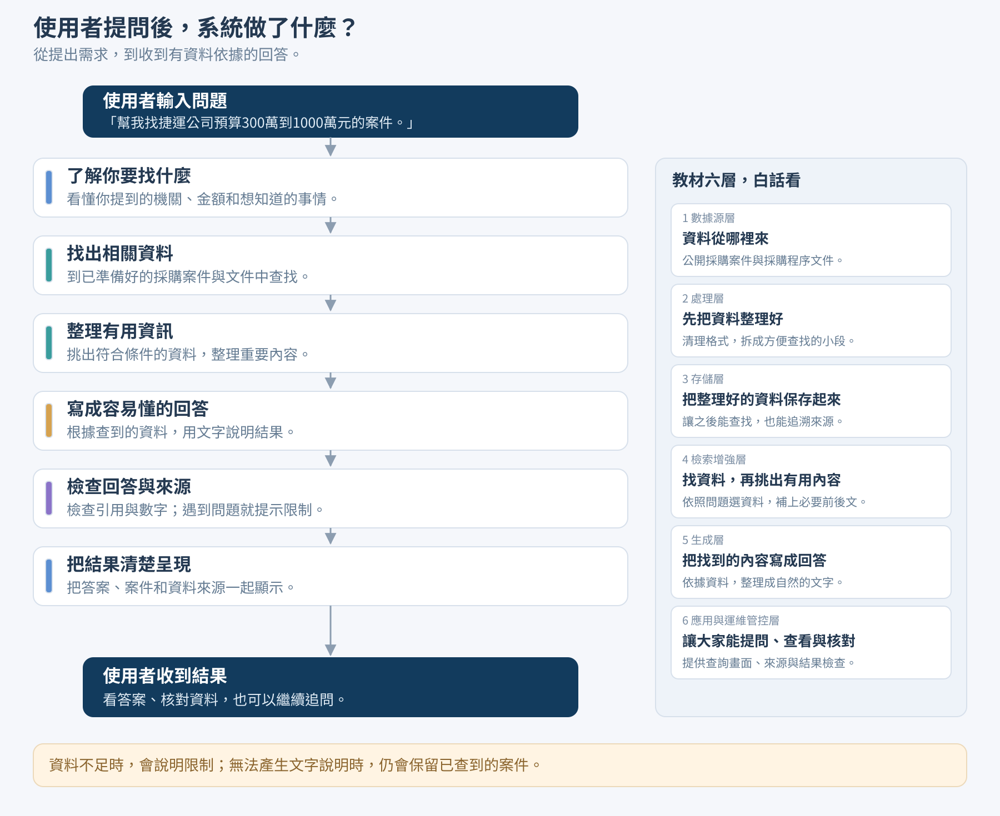

# 從提問到答案：白話流程

**使用者提問 → 了解需求 → 找資料 → 整理資訊 → 寫回答 → 檢查內容 → 清楚呈現 → 使用者收到結果。**

例如，使用者說「幫我找捷運公司預算300萬到1000萬元的案件」：系統先辨認想找哪個機關及金額，再從已準備好的案件查找，整理符合條件的資料，產生文字說明，檢查引用與數字，最後一起呈現答案、案件及來源。

圖右側保留教材六層，用白話說明各自負責的事情。前三層負責事前準備及保存資料，不是每次提問都重新執行；查詢、回答和檢查則使用已準備的資料。左側是時間順序，右側是責任分類，兩者不逐格對應。

資料不足時，系統說明限制，不一定產生完整回答。檢查引用及數字也不能保證每句話都正確，使用者仍可點開來源核對。

面試可說：「使用者描述想找什麼，系統先理解需求，再從準備好的資料中找出相關內容，整理成容易懂的回答。回傳前會檢查引用和數字，最後把答案、案件與來源一起交給使用者；資料不夠時就清楚說明。」

需要深入解釋時，再看[完整技術流程](architecture.md)。
