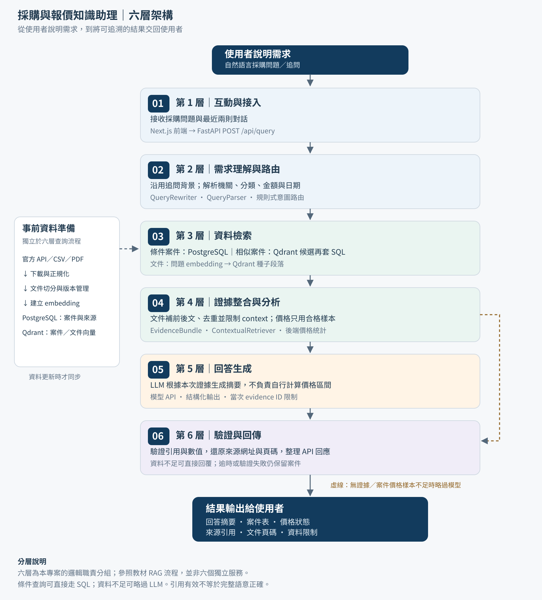
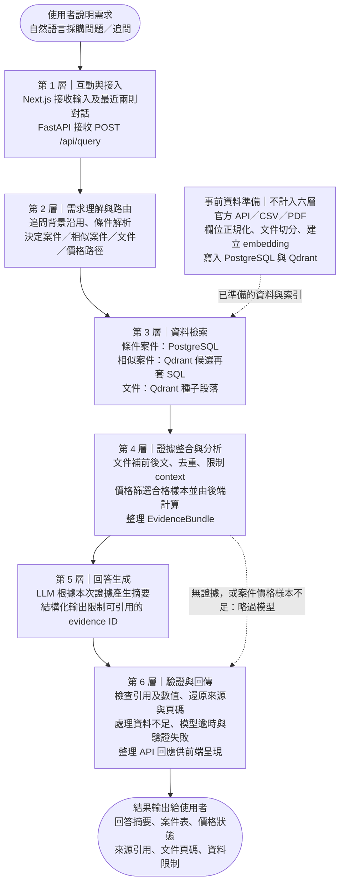

# 從使用者需求到結果：六層架構

本圖依教材「提問 → 檢索 → 補入上下文 → 生成答案 → 回到使用者」的 RAG 流程概念，將本專案實際職責整理為六層。教材現有架構圖片沒有明列六層名稱，因此以下是本專案的分層命名，不宣稱是教材原文。

「使用者說明需求」與「結果輸出給使用者」是起點、終點，不列入六層。資料同步與建索引屬事前準備，放在主流程旁邊，也不列入六層。

| 層級 | 作用 | 對應現有程式 |
| --- | --- | --- |
| 1. 互動與接入 | 接收問題、有限對話及 API 請求 | `frontend/src/components/QueryForm.tsx`、`frontend/src/app/page.tsx`、`backend/app/api/query.py` |
| 2. 需求理解與路由 | 沿用追問背景，解析機關、分類、金額、日期；選擇檢索路徑 | `backend/app/answering/query_rewriter.py`、`backend/app/search/query_parser.py`、`backend/app/runtime.py` |
| 3. 資料檢索 | SQL 條件搜尋、案件向量候選、文件種子段落 | `backend/app/search/case_repository.py`、`backend/app/retrieval/vector_repository.py` |
| 4. 證據整合與分析 | 相鄰段落、去重與 context 上限；篩選價格樣本、確定性統計 | `backend/app/retrieval/contextual.py`、`backend/app/retrieval/schemas.py`、`backend/app/analysis/pricing.py`、`backend/app/runtime.py` |
| 5. 回答生成 | 將問題、證據及價格結果送給模型，產生結構化摘要 | `backend/app/answering/openai.py`、`backend/app/answering/provider.py` |
| 6. 驗證與回傳 | 引用／數值驗證、失敗時保留案件、整理回應並呈現 | `backend/app/answering/validator.py`、`backend/app/answering/service.py`、`frontend/src/components/AnswerPanel.tsx` |

六層是邏輯職責，沒有拆成六個獨立服務；同一個 Python 模組可跨越數層。

面試講法：「使用者先用自然語言描述需求；第一層接收請求，第二層解析需求並選擇路徑，第三層查資料，第四層整理證據與計算合格的價格統計，第五層請模型生成摘要，第六層驗證並回傳，最後讓使用者看到案件、引用及限制。」

說明時須保留的界線：目前路由與追問沿用以規則為主；條件案件可直接查 SQL，不會全部都做 embedding；價格不足會略過模型；模型逾時仍保留案件；引用與數字驗證不等於完整語意正確。圖中不包含尚未實作的完整語意改寫、獨立 reranker 或公開部署。
