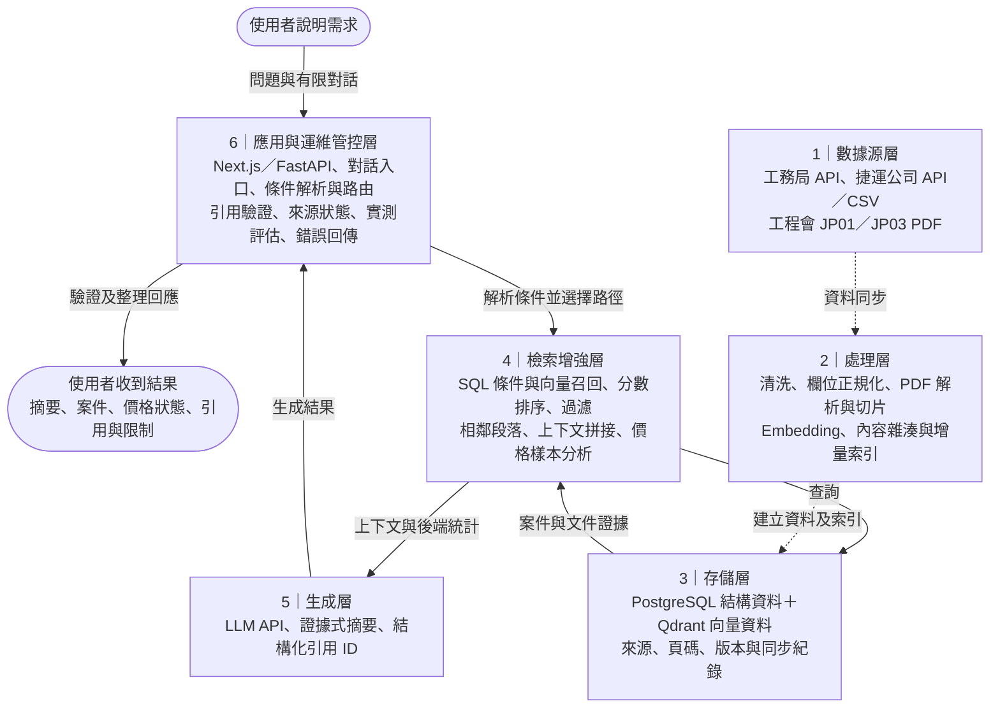

# 採購 RAG：依教材六層架構

本圖依使用者提供的「企業級 RAG 的六層架構」圖片，保留原六層名稱與編號。使用者輸入、使用者輸出置於六層之外；層級由上而下排列為 6、5、4、3、2、1，與教材一致。

六層是責任分層，不是每次提問依序走 1→6 的六個步驟。資料建置與即時查詢分開閱讀：

- **資料建置：** 1 數據源層 → 2 處理層 → 3 存儲層。新增或更新資料時執行。
- **使用者查詢：** 使用者說明需求 → 6 接入並解析 → 4 檢索增強 → 查詢 3 並取回證據 → 4 組合上下文 → 5 生成 → 6 驗證與呈現 → 使用者收到結果。
- **例外處理：** 無證據或案件價格樣本不足時，由 6 直接回傳限制而略過 5；模型逾時或驗證失敗時保留已查案件。

| 教材六層 | 本專案已實作 | 對應程式 |
| --- | --- | --- |
| 6. 應用與運維管控層 | Web／API、有限對話、需求解析與路由、來源狀態、引用與數值驗證、逾時回退、測試及評測紀錄 | `frontend/src/app/`、`backend/app/api/`、`backend/app/answering/service.py`、`query_rewriter.py`、`validator.py`、`backend/app/search/query_parser.py` |
| 5. 生成層 | 根據本次證據生成摘要，結構化輸出限制可引用的 evidence ID | `backend/app/answering/openai.py`、`provider.py`、`prompts.py` |
| 4. 檢索增強層 | 條件 SQL、向量候選再 SQL、相似分數排序、相鄰段落擴展與去重、context 上限、合格價格樣本與確定性統計 | `backend/app/runtime.py`、`backend/app/search/case_repository.py`、`backend/app/retrieval/vector_repository.py`、`contextual.py`、`backend/app/analysis/pricing.py` |
| 3. 存儲層 | PostgreSQL 案件、來源與同步紀錄；Qdrant 案件及文件向量；保存來源／頁碼／版本等中繼資料 | `backend/app/db/`、`backend/app/retrieval/qdrant.py`、`collections.py` |
| 2. 處理層 | API／CSV 正規化、民國日期及金額解析、PDF 切分、embedding、內容雜湊、可重跑同步 | `backend/app/ingestion/`、`backend/app/retrieval/embeddings.py`、`backend/app/cli.py` |
| 1. 數據源層 | 工務局與捷運公開採購資料；工程會兩份程序文件 | README 資料來源、`docs/procedure-sources.json` |

**教材能力與目前實作的界線：** 教材列出企業級完整能力，本作品目前是本機公開資料展示。尚無獨立 reranker、權限控制／權限標籤、正式監控告警及自動知識更新；已提供來源狀態、基本服務健康檢查、測試與人工啟動同步。不能將六層都畫出來解讀為教材每項能力都已實作。

面試說明：「使用者從第六層的 Web／API 說明需求，系統解析條件後交給第四層查詢第三層。第四層把案件或文件整理成上下文，送第五層生成摘要，再回第六層做引用及數值驗證，最後輸出給使用者。底下的一到三層則是事前把官方資料清洗、切片、向量化並保存的流程。」

六層是邏輯責任，不是六個獨立服務；同一模組可能承擔多層職責。條件案件可直接查 SQL，不會全部都做 embedding；引用與數值驗證不代表完整語意正確。
